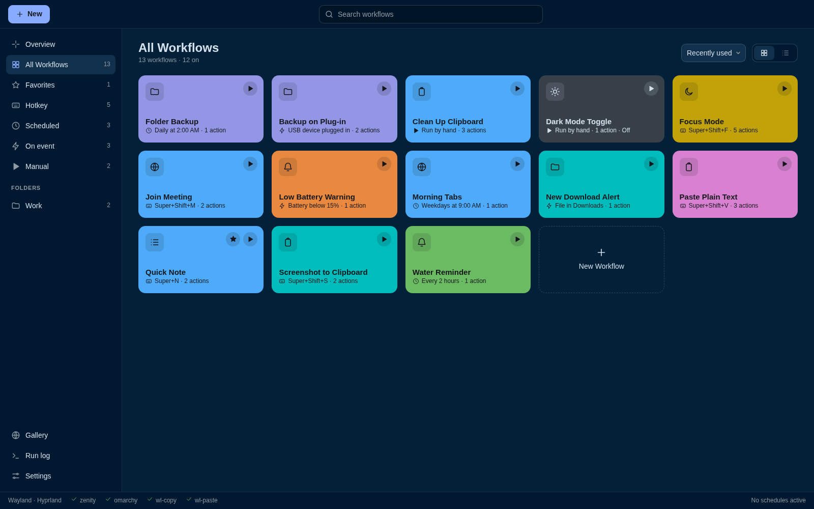
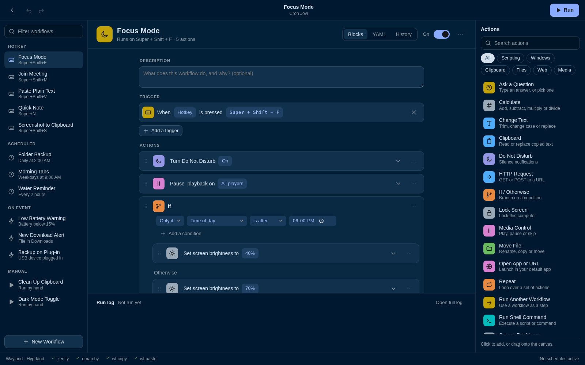
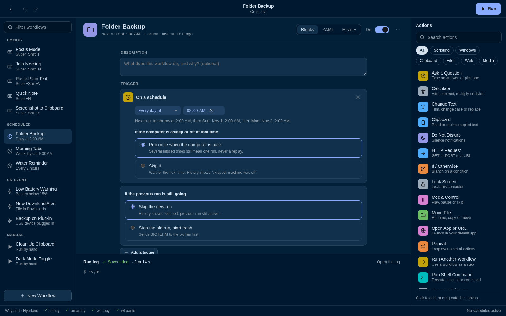
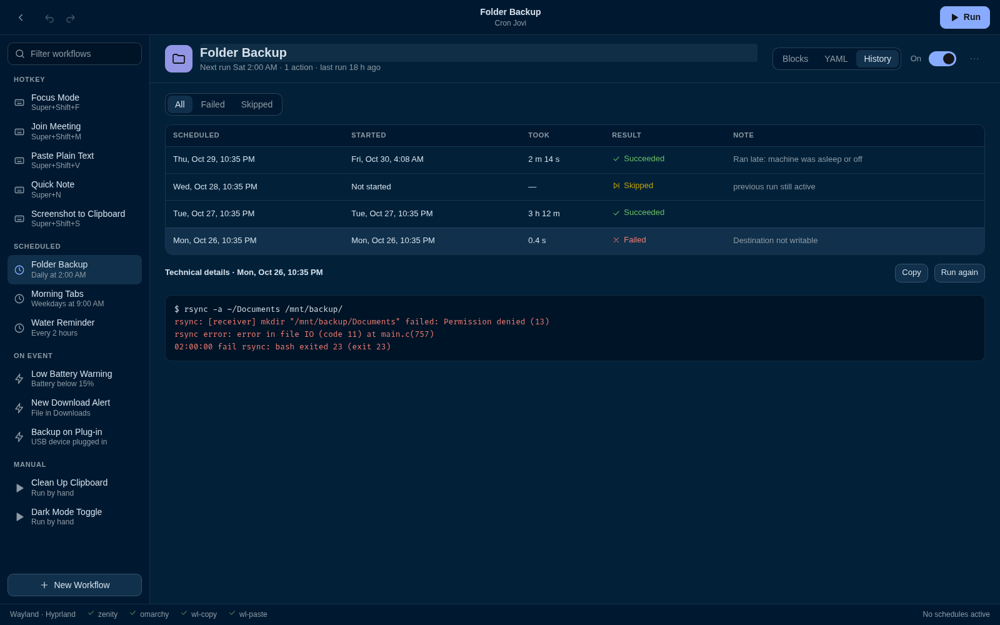

# Cron Jovi

**Apple Shortcuts for the Linux desktop.** Pick when something should happen, snap
together what it should do, and press Run. No coding needed, no cloud, no accounts,
no AI: it's plain, predictable automation that runs on your own computer.

Built for Wayland (Hyprland and niri), and it picks up your theme on Omarchy.



<p align="center">
  <a href="https://ko-fi.com/jgarza9788"><strong>☕ Enjoying Cron Jovi? Support it on Ko-fi</strong></a>
</p>

## What it can do

- **Build with blocks.** Drag actions into place, with If/Otherwise and Repeat. Every change saves itself, and there's undo.
- **Run on your terms.** Hotkeys, schedules, file changes, USB devices, battery and power, login, waking from sleep, or web requests.
- **Watch it work.** The running step lights up as it goes, like in Shortcuts.
- **Understand what went wrong.** "Can't find /mnt/backup. Check that it exists, and that any drive it's on is plugged in." Not `exit 23`.
- **Trust the schedule.** You choose what happens if the computer was off, or the last run is still going. Every run gets a history row, even skipped ones.
- **Stay in plain files.** Each workflow is one readable YAML file, so the app is optional and workflows can live in git.
- **Share safely.** Shared workflows show what they'd do before you add them, and arrive switched off.



## Install

You'll need Linux with systemd and Python 3.11 or newer.

    git clone https://github.com/jgarza9788/cron-jovi.git
    cd cron-jovi
    ./install.sh

Then open **Cron Jovi** from your app launcher, or run `cronjovi gui`.

The installer sets everything up inside your home folder and doesn't need root. It
asks before adding the one line to your compositor config that loads hotkeys, and
makes a backup first. Close the app before updating: run `./install.sh` again and
your workflows are kept.

For its own window the app needs WebKitGTK (`webkit2gtk-4.1` and `python-gobject` on
Arch). Without them it opens in your browser instead.

To remove it, `./uninstall.sh` takes everything out and keeps your workflows and
history. `./uninstall.sh --purge` deletes those too.

New to this? Start with the **[user guide](docs/USER-GUIDE.md)**.

## Your first workflow

1. Press **New** and pick one of the 12 starter ideas, like Water Reminder or Quick Note.
2. Look over its steps. Starter ideas arrive switched off, so nothing happens yet.
3. Press **Run** to try it, then flip the switch to **On**.

Press the **⋯** on any step to move, copy or turn it off, or open a step and use
**Test this step** to try it alone.

## Actions

There are 20 built in. Some use a small Linux tool, and the bar at the bottom of the
app tells you if one's missing and how to install it.

| Action | What it does | Uses |
| --- | --- | --- |
| `shell` | Run a command or script | bash, or a shell you pick |
| `notify` | Show a desktop notification | notify-send |
| `open` | Open an app, file or web address | xdg-open |
| `clipboard` | Read or replace copied text | wl-clipboard |
| `type` | Type into the focused app | wtype or ydotool |
| `http` | GET or POST to a web address | |
| `file` | Move, copy or rename | |
| `media` | Play, pause or skip | playerctl |
| `volume` | Set, mute or unmute the sound | wpctl or pamixer |
| `brightness` | Set the screen brightness | Omarchy, brightnessctl or ddcutil |
| `dnd` | Do Not Disturb on or off | Omarchy, mako, swaync or dunst |
| `screenshot` | Grab the screen or a selection | grim, slurp, wl-clipboard |
| `workspace` | Jump to a workspace | hyprctl or niri |
| `lock` | Lock the screen | Omarchy or loginctl |
| `ask` | Ask a question or offer choices | zenity |
| `text` | Trim, change case, replace or split | |
| `math` | Work out a sum | |
| `set` | Remember a value | |
| `wait` | Pause for a while | |
| `run` | Run another workflow as a step | |

`cronjovi actions` lists their options. To add one, drop a file in `cron_jovi/actions/`.

## Workflow files

Files live in `~/.config/cronjovi/workflows/`. The file name is the workflow's id:
`clip-shout.yaml` runs as `cronjovi run clip-shout`.

```yaml
name: Clip Shout
description: ""                  # optional, as long as you like
enabled: true                    # false removes its timer and hotkey on sync
trigger:
  hotkey: Super+Shift+U
steps:
  - action: clipboard
    save_as: clip
  - action: shell
    run: echo {{ clip }} | tr a-z A-Z
    timeout: 10s
    save_as: loud
    stop_on_error: true          # otherwise later steps still run
  - if:
      equals: ["{{ loud }}", "HELLO"]
    then:
      - action: notify
        text: Hi yourself
    else:
      - action: clipboard
        op: set
        text: "{{ loud }}"
on_failure:                      # runs after a failed step; {{ error }} is set
  - action: notify
    text: "{{ error }}"
```

A step that fails marks the whole run failed, even when later steps carry on.
`skip: true` turns a step off without deleting it.

Editing blocks in the app rewrites the file and drops any YAML comments. Editing on
the YAML tab keeps them. If a file changes outside the app, the app won't overwrite it.

### Variables

`save_as` names a step's output, and `{{ result }}` is always the previous step's.
`{{ date }}`, `{{ time }}`, `{{ weekday }}` and `{{ workflow }}` are always there. A
list gives `{{ parts.count }}` and `{{ parts.1 }}`, counting from 1.

In `shell` commands, values are shell-quoted for you. Write `echo {{ clip }}`, not
`echo "{{ clip }}"`.

The `math` action works out sums with variables: `sum: "{{ num }} * 2 + 1"`.

### Conditions

Everything under `if:` must hold:

| Condition | Example |
| --- | --- |
| `time_of_day` | `{ after: "22:00", before: "06:00" }` |
| `weekday` | `[Mon, Fri]` |
| `equals` | `["{{ answer }}", "yes"]` |
| `contains` | `["{{ clip }}", "http"]` |
| `file_exists` | `~/backup.lock` |
| `app_running` | `firefox` |
| `on_battery` | `true` |
| `command` | `ping -c1 example.com` |
| `not` | `{ file_exists: ~/x }` |

### Repeat

`repeat:` takes a number, a variable, a list, or text. Nested `steps:` run each time,
with `{{ index }}` and `{{ item }}` set.

```yaml
- repeat: "{{ num }}"            # as many times as num says
  steps: [...]
- repeat: "one,two,three"        # once per part
  split: ","
  steps: [...]
```

Without `split`, text goes line by line.

## Triggers

A workflow can have several. With none, it runs when you press Run.

```yaml
trigger:
  hotkey: Super+Shift+F
  schedule: daily at 02:00
  file: { path: ~/Downloads, pattern: "*.pdf", events: [created], recursive: false }
  device: { match: SanDisk, event: added }   # or removed; leave match out for any
  battery: 15                                # once per drop below 15%
  power: unplugged                           # or plugged
  login: true                                # once per session
  wake: true                                 # after sleep
  webhook: true
```

Actions can read what happened: `{{ file.name }}`, `{{ file.path }}`,
`{{ device.name }}`, `{{ battery.percent }}`, `{{ webhook.body }}`.

Run `cronjovi sync` after changing a file by hand. The app does this for you.

- **Hotkeys** are compositor bindings, because Wayland has no portable global hotkeys.
- **Files** fire once they've been quiet for a second, so a download fires when it finishes. Partial and hidden files are ignored.
- **Batteries** means built-in ones, not wireless mice.
- **Webhooks** listen on 127.0.0.1:8765 for a POST to the address from `cronjovi webhook <name>`. They can't be reached from other computers, and the secret stays out of the workflow file.

A workflow that fires more than 30 times in a minute is held back, with a note in
history, which stops one from re-triggering itself forever. Event triggers use a
small systemd user service that runs only while a workflow needs it.

## Scheduling



`schedule:` takes `daily at 02:00`, `weekdays at 09:00`, `weekly on Fri at 17:30`,
`every 2h`, `every 15m`, or any systemd `OnCalendar` expression. Two choices are
always yours to make:

| Option | Value | What happens |
| --- | --- | --- |
| `if_missed` | `run_once` (default) | One run when the computer is back, however many times were missed |
| | `skip` | Wait for the next time. History shows `machine was off` |
| `if_running` | `skip` (default) | History shows `previous run still active` |
| | `restart` | SIGTERM to the old run, SIGKILL after 10 s, then start fresh |

`if_running` also covers hotkey and manual runs, so a double-tapped hotkey can't start
two copies.

Schedules are systemd user timers, so they stop when you log out unless you run
`loginctl enable-linger`. Time away counts as missed.

## History and errors



Every run records its scheduled time, start, finish and output, and each workflow
keeps its last 500. If a run fails while you aren't watching, you get a notification.

Failures appear as plain sentences from a lookup table, `cron_jovi/error_table.yaml`.
It holds patterns for what programs print, plus exit codes for 35 programs. Add your
own, or replace any entry, in `~/.config/cronjovi/errors.yaml`:

```yaml
output:
  - match: backup drive locked
    say: Unlock the backup drive first.
exit_codes:
  mytool:
    4: My tool needs its dongle.
```

`cronjovi errors` lists recent failures the table couldn't translate. The exact output
and exit code stay under Technical details in History, and in `cronjovi logs`.

## Sharing

**Only add workflows from people you trust.** A workflow can do anything you can do
on your computer.

Export a workflow from its **⋯** menu, which leaves out your personal settings and
warns you if it spots something like a password. To bring workflows in, use Import in
Settings, or add a gallery: a folder or git repo of workflow files, at its top level
or in `workflows/`.

    cronjovi gallery add https://example.com/someone/workflows.git
    cronjovi gallery list
    cronjovi gallery install <id>:<file>

Galleries are only read. Nothing in one runs until you've reviewed it, added it and
switched it on, and symlinks in a repo are ignored. Updates never change a workflow
you've already added.

## Command line

Everything in the app is plain files underneath, so the CLI works alongside it.

    cronjovi new "Water Reminder" --schedule "every 2h"
    cronjovi new "Focus Mode" --hotkey Super+Shift+F
    cronjovi run focus-mode
    cronjovi list
    cronjovi logs nightly-backup
    cronjovi logs --run 12         # one run, with its output
    cronjovi enable <name>         # or disable; keeps your file's comments
    cronjovi sync                  # after changing triggers by hand
    cronjovi sync --link-hotkeys   # add hotkey loading to your compositor config
    cronjovi pause                 # stop every trigger; `resume` turns them back on
    cronjovi validate              # check every workflow file
    cronjovi doctor                # which Linux tools are installed
    cronjovi actions               # every action and its options
    cronjovi errors                # failures with no plain translation
    cronjovi webhook <name>        # a workflow's webhook address
    cronjovi gallery               # shared workflows
    cronjovi gui                   # the app
    cronjovi completion            # bash tab completion

## Privacy and security

Nothing leaves your computer unless a workflow you wrote sends it. The app talks to a
local server that only listens on 127.0.0.1 and needs a token created for each launch.
Run logs can hold what your commands printed, and Settings can clear them.

## Development

    python3 -m unittest discover -s tests

The app's API tests are skipped unless Flask is installed. The design is in
[docs/CronJovi-Design-Document.docx](docs/CronJovi-Design-Document.docx).

## Support

Cron Jovi is free. If it saves you some time, you can help keep it going:

**[☕ Buy me a coffee on Ko-fi](https://ko-fi.com/jgarza9788)**
